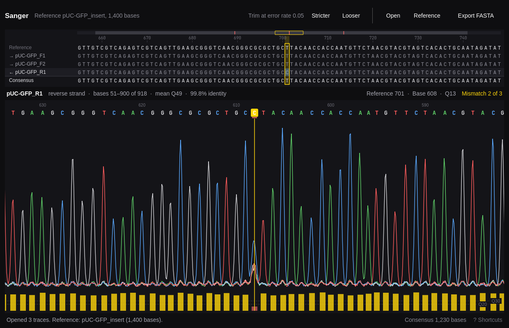

# Sanger



A viewer for Sanger sequencing traces. Open AB1 or SCF chromatograms with a FASTA reference and Sanger:

- shows each read's chromatogram with its base calls and quality scores,
- trims the low-quality ends by Mott's algorithm, or wherever you trim by hand,
- aligns every read to the reference, flipping reverse reads, and
- builds a quality-weighted consensus you can export as FASTA.

**N** jumps to the next place a read disagrees with the reference, and shows the chromatogram of the read that disagrees, so checking a clone is a matter of pressing N until you're back at the start.

Sanger is a native app for Omarchy and follows its theme and language.

## Install

```sh
bin/install
```

This builds the app and installs it as an Arch package, so **Sanger** appears in the app launcher (Super + Space). It needs `qmake6`, `make`, a C++ compiler, and Qt 6, all of which Omarchy includes.

## Use

Drop traces and a reference onto the window, or press **O** to open them; Sanger tells traces from references by their contents. Without a reference it shows each read and its trim, and exports the trimmed reads.

The top panel stacks the reads under the reference, with the consensus beneath. Bases that agree with the reference are grey; ones that don't are highlighted, and the strip along the top marks every mismatch in the whole alignment. Low-quality calls are faded. Click a base to put the cursor there. The bottom panel is the selected read's chromatogram around the cursor, with its trimmed ends shaded and a quality bar under each call. Drag or scroll it to look around, and click a call to move the cursor to it.

| Key | Action |
| --- | --- |
| Space | Next mismatch, or open files when there are none |
| N / Shift+N | Next or previous mismatch |
| ← → | Move the cursor one column |
| Shift+← → | Move the cursor ten columns |
| Home / End | Start or end of the consensus |
| ↑ ↓ | Select the read above or below |
| [ / ] | Trim the selected read's start or end at the cursor |
| \ | Trim the selected read by quality again |
| T / Shift+T | Stricter or looser quality trim for every read |
| X | Leave the selected read out of the consensus, or back in |
| O | Open traces or a reference |
| R | Open a FASTA reference |
| E | Export the consensus as FASTA |
| Ctrl+= / Ctrl+- | Zoom the chromatogram |
| Ctrl+Z / Ctrl+Shift+Z | Undo or redo |
| ? | Show every shortcut |
| Q | Quit |

Sanger never changes your trace files. Exports are written beside the target and renamed into place.

## How it decides

- **Trimming** uses Mott's algorithm with an error-probability limit of 0.05: the stretch of the read where the calls' error rates fall furthest below the limit. **T** and **Shift+T** step the limit through 0.001–0.2. Old traces without quality scores aren't trimmed.
- **Alignment** places each read on the reference with affine gaps, ends free so reads can overhang the reference, and a read's ends clipped where they stop matching. Each read is tried both ways round. Long references are narrowed to the read's best 12-mer diagonal first.
- **Consensus**: every included read votes for its call with the call's Phred quality, and a gap votes with the weaker of the calls beside it. A tie becomes N, as does any reference stretch between reads that no read covers.
- **Mismatches** are the columns where any included read disagrees with the reference: a different base, a gap, an insertion, or an N.

## Command line

Every command works without a display, takes `--json`, and exits 1 with the reason on stderr when something is wrong.

```sh
sanger open [files...]                    # the viewer
sanger info reads/*.ab1                   # length, quality, and trim of each trace
sanger trim reads/*.ab1 -o trimmed.fasta  # quality-trimmed reads
sanger align ref.fasta reads/*.ab1        # strands, spans, identity, and every mismatch
sanger consensus ref.fasta reads/*.ab1 -o consensus.fasta
sanger skill install                      # teach coding agents to use sanger
```

## Develop

```sh
bin/build   # build/sanger
bin/test    # Qt Test, offscreen
tools/strings > strings.json   # every translatable string, for catalogs in src/i18n
```

## License

MIT. The theme, translator, file picker, and command line follow [Omacut](https://github.com/omacom-io/omacut) and [Hype](https://github.com/omacom/hype).
